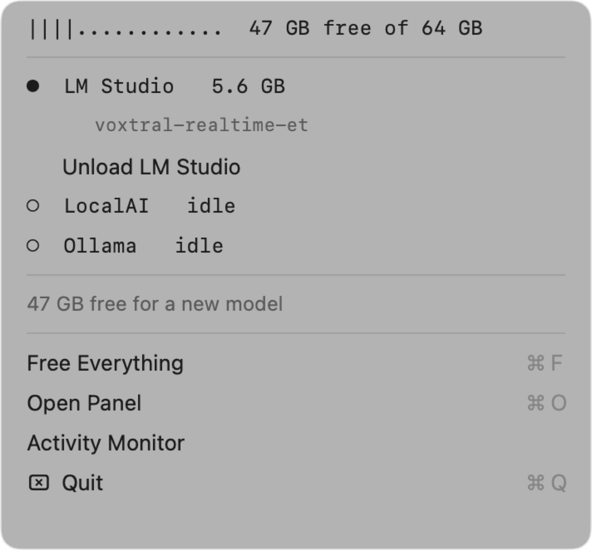
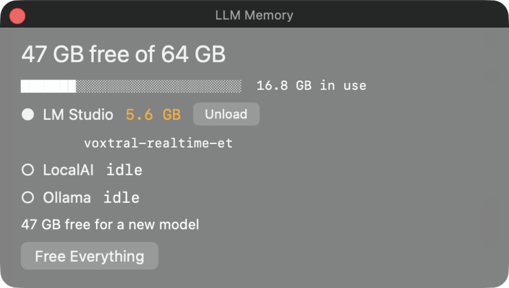

# llmctl

See which local LLMs are holding your Mac's RAM, and free them.

A ~500-line Python CLI with no dependencies, plus an optional menu bar app that
renders it. Covers **LM Studio**, **LocalAI** and **Ollama**, and finds the
`llama.cpp` / `mlx-lm` server processes that hold weights even when every engine
reports "nothing loaded".

<p align="center">
  
  &nbsp;&nbsp;
  
</p>

## Why not just use Activity Monitor

Because the number you need is not the number it shows.

- **A model in the page cache is not memory pressure.** A 20–46 GB GGUF that has
  been read off disk sits in file-backed cache, which is reclaimable — a new
  model can have it. Count it as "used" and a machine with plenty of room looks
  full. `llmctl` uses app memory + wired + compressed, which is what Activity
  Monitor's own "Memory Used" means, and nothing else.
- **The memory hides in idle servers.** An engine can report "no models loaded"
  while its server process still pins the weights with `mlock` — 18.5 GB of it,
  on the machine this was written for. Nothing in the engine's own UI shows that,
  and unloading the model does not release it.
- **A model can be resident in a process no engine will tell you about.** MLX
  runtimes inside a host app bind no port and appear in no model list.

## Install

```sh
git clone https://github.com/foggylulu/llmctl.git
cd llmctl
./install.sh              # symlinks the CLI onto your PATH, builds the menu bar app
./install.sh --cli-only   # just the CLI
./install.sh --uninstall
```

Requires macOS 13+ and the system Python 3 (no pip install, no venv). The menu
bar app needs a Swift toolchain to build; the CLI does not need one at all, and
the two are fully independent — the app is a renderer for `llmctl status --json`.

Nothing here needs root. `reclaim --purge` is the one command that asks for your
password, and it says so before it does.

## Use it

```
$ llmctl status --fit 28

  MEMORY  [████████████░░░░░░░░░░░░░░░░░░░░░░]  23.5 / 64 GB used
          40.5 GB available for a model  (2.9 GB wired)

  ● LM Studio            11.9 GB held
      └ qwen/qwen3.5-9b  ctx 262144
      └ voxtral-realtime-et
  ○ LocalAI              88 MB held
  ○ Ollama               0 MB held

  a 28 GB model: fits
```

`free` unloads, then **verifies**, because an engine can report success and stay
resident. The only trustworthy report is the memory that actually came back:

```
$ llmctl free

  LM Studio    unload sent
  LocalAI      nothing loaded
  Ollama       nothing loaded

  freed 6.5 GB
  still resident: voxtral-realtime-et (LM Studio)
     -> pinned by the app itself; quit it to release the memory
```

That last line is the point. The 9B unloaded and gave back 6.5 GB; the voice
model did not, because the app itself holds it. A tool that printed "freed 6.5
GB" and stopped would have been lying by omission.

`reclaim` goes after what `free` cannot reach — idle server processes — and will
always show you the plan first:

```
$ llmctl reclaim --dry-run

  would do:
    unload  LM Studio: voxtral-realtime-et

  inference servers still running:
    LocalAI    pid 85043   88 MB     unknown
     -> these pin memory with mlock; `llmctl reclaim --servers` stops idle ones

  largest non-AI processes you own:
    claude                       pid 15299   1.1 GB
    mediaanalysisd               pid 425     619 MB
     -> quit these yourself; llmctl will not touch them
```

| command | does |
|---|---|
| `llmctl` / `llmctl status` | the table above |
| `llmctl status --json` | machine-readable; what the menu bar app consumes |
| `llmctl status --fit 28` | would a 28 GB model fit right now? (repeatable) |
| `llmctl free [engine]` | unload models, then verify |
| `llmctl reclaim` | unload idle models |
| `llmctl reclaim --servers` | also stop **idle** inference servers |
| `llmctl reclaim --purge` | also flush the page cache (asks for your password) |
| `llmctl reclaim --dry-run` | print the plan, change nothing |

## Rules it follows

- **Never stop a server that is mid-generation.** llama.cpp is checked through
  `/slots`, using the port and API key read out of its own argv, because both are
  ephemeral and appear in no config file. mlx-lm is checked by its log's mtime. A
  server whose state cannot be determined is reported as `unknown` — not as idle.
- **Never touch a process it does not understand.** Large non-AI processes are
  listed so you can judge them, and that is all.
- **Never launch what it is monitoring.** `lms` starts LM Studio if it is not
  running, which once made the app un-quittable: quit it, and the next poll
  respawned it seconds later. So the CLI is invoked only when the app is already
  listening or already in the process table. There are four tests pinning this
  shut, because it is the kind of bug that comes back.
- **Absent is not zero.** Unknown busy state, unreadable engine, missing CLI —
  each is reported as itself.

## Configuration

All optional; sensible defaults for a normal install.

| variable | default |
|---|---|
| `LLMCTL_LMS` | `~/.lmstudio/bin/lms` |
| `LLMCTL_OLLAMA` | first `ollama` on PATH, then Homebrew's paths |
| `LLMCTL_LMSTUDIO_URL` | `http://127.0.0.1:1234` |
| `LLMCTL_LOCALAI_URL` | `http://127.0.0.1:8080` |
| `LLMCTL_MLX_LOG` | `~/.local/state/mlx-lm/server.log` |
| `LOCALAI_API_KEY` | also read from `~/.config/llmctl/config.env` |

The menu bar app finds the CLI on PATH, in `~/bin`, `/usr/local/bin`,
`/opt/homebrew/bin`, inside its own bundle, or wherever `LLMCTL` points. A GUI
app launched from Finder inherits almost no PATH, which is why that list exists.

## Not possible on macOS, at any privilege level

Stated because these are the questions people ask next:

- **Releasing compressed or swapped memory directly.** There is no API; the
  kernel reclaims on demand.
- **Per-process swap attribution.** Not exposed.
- **Per-process memory limits.** No cgroups equivalent.

## Tests

```sh
python3 -m unittest discover -s tests -v    # 41 tests, no engine required
```

Every test is a pure function over text some other program printed, which is
exactly where a wrong number comes from. Two of them exist because of bugs found
this way: `ps` **truncates a column to a fixed width when another column follows
it**, which reported `mediaanalysisd`'s command as the literal string
`/System/Library/` — a process with no name — and reported LocalAI's as
`/opt/homebrew/bin/`, silently hiding a running server from the report. Each
field now gets its own `ps` call, with that field last.

## See also

- [**mac-ai-activity**](https://github.com/foggylulu/mac-ai-activity) — the same
  machine's inference *behaviour* rather than its memory: joules per token,
  per-slot llama.cpp telemetry, die temperatures. `llmctl` answers "what is
  holding my RAM"; that answers "what did that generation cost".
- [**wake-on-llm**](https://github.com/foggylulu/wake-on-llm) — turning a big
  local model on and off from your phone, from anywhere, over Tailscale.
- [**solvr-ai**](https://github.com/foggylulu/solvr-ai) — a maths tutor app for
  iOS and macOS that runs entirely on Apple's on-device model: no API key, no
  server, no network.

## License

MIT — see [LICENSE](LICENSE). Contributions sign off with the
[DCO](CONTRIBUTING.md#sign-your-work-dco).
